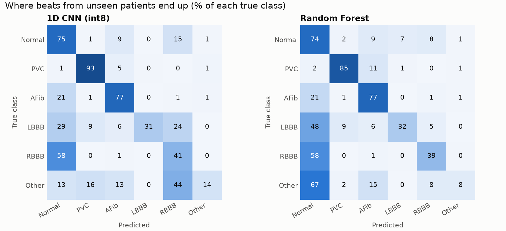
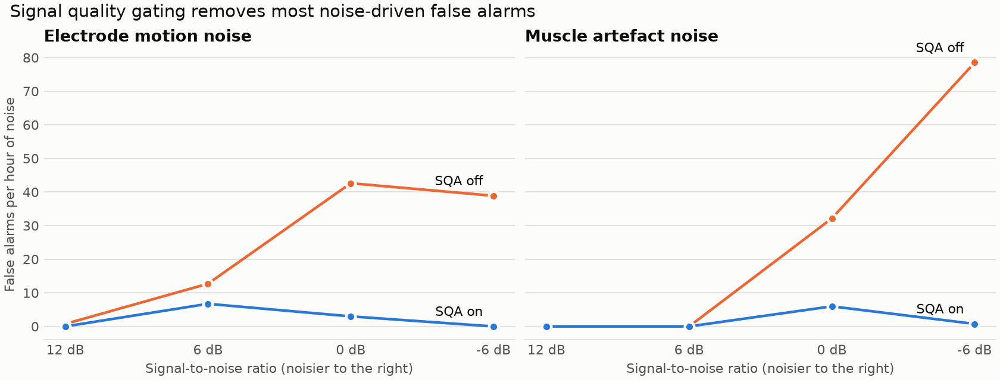

# CardioEdge-ESP32

**Signal-quality-aware, real-time ECG arrhythmia detection that runs entirely on a low-cost ESP32.**

B.Tech project: *AI-Based Real-Time ECG Signal Analysis and Multi-Class Cardiac Abnormality Detection Using an Embedded System.*

An ESP32 reads a single-lead ECG from an AD8232 front end. It filters the signal, checks whether the signal can be trusted, finds every heartbeat and classifies each clean beat with **two on-device models running side by side**: an int8 **TensorFlow Lite Micro 1D CNN** and a **Random Forest**. Verdicts appear on an OLED and on a live phone dashboard served by the ESP32 itself, and a buzzer sounds on sustained abnormal rhythms. **No cloud, no phone app and no internet connection are needed.**

## At a glance

| | |
|---|---|
| **99.11%** | R-peak sensitivity (PPV 99.59%) on 100,460 MIT-BIH beats |
| **71 → 0.7** | False alarms per hour at -6 dB muscle noise, without vs with the signal-quality gate |
| **0.85** | PVC beat F1 on unseen MIT-BIH patients (recall 93%) |
| **77% / 83%** | AFib rhythm recall / precision on full test recordings |
| **0.82** | CNN macro-F1 on 95 unseen PTB-XL patients (accuracy 84%) |
| **17 KB** | Int8 CNN with a 3.7 KB tensor arena: 27% of RAM and 41% of flash for the whole firmware |
| **240 / 240** | Emulated ESP32 outputs identical to the PC on every test vector |
| **123** | Test patients, none of them seen in training |

Every number above is traceable to a JSON file in [`results/`](results).

## What makes it different

- **Honest, patient-wise evaluation.** Many published ECG classifiers report 95-99% using random beat splits, where the same person's beats appear in both training and testing. Here every patient sits on exactly one side of the split (de Chazal's DS1/DS2 for MIT-BIH, PTB-XL's patient-safe folds), so the scores predict what happens with a new person at a demo.
- **One DSP codebase for device and training.** `firmware/lib/ecg_core` is plain C++ with no Arduino dependency. The ESP32 runs it live, and Python compiles the same source into a shared library (through `ziglang`) to build the training data and run the tests. The features the models learned from are, byte for byte, the features the device computes.
- **It knows when not to answer.** A signal-quality gate scores every 5 s of signal and blocks classification and alarms when electrodes slip or muscle noise takes over. That cuts false alarms in heavy noise by about 99%, the difference between a buzzer people trust and one they switch off.
- **Two classifiers, compared on the device.** Both the CNN and the Random Forest run on every beat, so the comparison in the results is made on real on-device outputs, not two separate experiments.
- **Verified on an emulated ESP32.** A QEMU (Xtensa) self-test boots the real firmware binary and checks it against host inference. Emulation caught two bugs that compiling never would: demo samples losing their sign, and per-channel Dense weights silently misread by TFLite Micro.
- **Demo-ready without a patient.** Built-in clips from test-set patients show Normal, PVC, AFib, bundle branch blocks and a noise burst at the press of a button.
- **Reproducible end to end.** Public PhysioNet data, a CPU-only training pipeline, pinned dependencies and 50 automated tests.

## How it works

```text
Electrodes -> AD8232 -> ESP32 ADC1 (GPIO 34, 250 Hz)
  -> Filters: 0.5 Hz high-pass, 50 Hz notch, 40 Hz low-pass
  -> Adaptive Pan-Tompkins R-peak detection
  -> Signal quality: amplitude, noise (SNR + kurtosis), baseline, morphology
        bad  -> "Please reposition electrodes", no classification, no alarm
        good -> beat extraction (delayed about 2 s, so the next RR interval is known)
             -> 1D CNN (TFLite Micro)  +  Random Forest
             -> AF rhythm rule (per classifier)
             -> rolling 10-beat verdict
  -> OLED, buzzer/LED, phone dashboard, event log
```

**1. Filtering.** A 0.5 Hz high-pass removes baseline wander, a 50 Hz notch removes mains pickup and a 40 Hz low-pass removes muscle and ADC noise, while keeping QRS energy. Each stage has its own test.

**2. R-peak detection.** An adaptive Pan-Tompkins detector learns the signal level in about 2.5 s, and adapts to each patient's amplitude, so detection doesn't depend on the input gain (tested).

**3. Signal quality assessment.** Every 0.5 s, the last 5 s are checked for amplitude, SNR, kurtosis, baseline movement and beat-to-beat shape consistency, plus the AD8232's lead-off pins. Recovering needs two good checks in a row, so a flickering electrode can't trigger a burst of verdicts.

**4. Beat features.** Each beat is held about 2 s so its following RR interval is known, then described three ways:

| Input | Size | Used by |
|---|---|---|
| Normalised waveform, 240 ms before R to 400 ms after | 160 samples | CNN |
| Rhythm context: RR ratios, irregularity, entropy, template similarity | 13 values | CNN and RF |
| Morphology: QRS width, amplitudes, slopes, regional energy | 32 values | RF |

**5. Classification.** Both models classify every clean beat:

| | 1D CNN | Random Forest |
|---|---|---|
| Structure | 3 conv blocks (8/16/24 filters, BatchNorm, ReLU6, max-pool) on the waveform, joined with a dense branch on the rhythm context | 30 trees, at most 200 leaves each, majority vote |
| Size | 9,574 parameters, 17 KB int8 | 11,970 nodes, 105 KB |
| Runtime | TensorFlow Lite Micro, reference kernels | Generated C header, no library |

**6. Rhythm logic.** An RR-irregularity rule turns irregular narrow beats into AFib and regular "AFib" beats back into Normal. A rolling 10-beat verdict smooths single-beat errors, and the alarm fires only after 8 consecutive abnormal verdicts, so one odd beat never sounds the buzzer.

**Tasks and timing (dual core):**

| Core | Task | Role |
|---|---|---|
| 1 | Acquisition | A hardware timer fires every 4 ms (250 Hz) and pushes source-tagged, sequence-numbered samples into a 128-sample queue (about 512 ms) |
| 1 | DSP | Filtering, QRS, SQA, beat extraction, both classifiers, rhythm logic |
| 0 | UI | OLED refresh, HTTP and WebSocket dashboard, serial commands |

- A source change or a missing sequence number resets the pipeline, HRV and verdicts. The firmware never inserts made-up samples.
- The **CNN verdict controls the alarm**, and both verdicts are displayed.
- From power-on, the first verdict usually arrives within about 15 s.

Full contracts, latency budget and design decisions: [docs/ARCHITECTURE.md](docs/ARCHITECTURE.md).

## Classes detected

| Class | Status | Source annotations |
|---|---|---|
| Normal | Demo-ready | N outside AF |
| PVC (premature ventricular contraction) | Demo-ready | V |
| AFib (atrial fibrillation) | Demo-ready | N during an AFIB rhythm |
| LBBB (left bundle branch block) | Experimental | L |
| RBBB (right bundle branch block) | Experimental | R |
| Other (supraventricular premature beats) | Experimental | A, a, J, S |

Fusion, escape and flutter beats are not used for training or scoring. Heart-rate variability (SDNN, RMSSD, pNN50) is computed alongside, tested against the textbook definitions.

## Results

All figures come from **123 test patients the models never saw in training**: 22 from MIT-BIH, 6 from the MIT-BIH AF database and 95 from PTB-XL. Full analysis: [docs/RESULTS.md](docs/RESULTS.md).

### Detection and signal quality

| Capability | Result |
|---|---|
| R-peak detection | Sensitivity **99.11%**, PPV **99.59%** on 44 MIT-BIH records, 100,460 beats |
| R-peaks through a simulated AD8232 + ESP32 ADC | Sensitivity stays at **99.3%** |
| False alarms, muscle noise at -6 dB | **71.0 → 0.7** per hour with the quality gate |
| False alarms, electrode motion at -6 dB | **41.1 → 0.0** per hour with the quality gate |
| Beat accuracy inside heavy muscle noise | **36.8% → 71.5%** with the quality gate |
| Clean signal accepted by the gate | **98.0%** |

### Beat and rhythm classification

| Capability | Result |
|---|---|
| PVC beats, MIT-BIH test patients | Precision 0.79, recall **0.93**, F1 **0.85** |
| AFib rhythm verdict | Recall **77%**, precision **83%** |
| AFib beats, AF database | Precision **0.89**, F1 0.82 |
| Normal beats, PTB-XL | Recall **0.99** |
| LBBB / RBBB, PTB-XL | Precision **1.00 / 0.91**, recall 0.72 / 0.61 |

### Classifier comparison

Each classifier is followed by the AF rhythm rule, exactly as on the device.

| Metric (123 test patients, 99,234 beats) | 1D CNN (int8) | Random Forest |
|---|---:|---:|
| Accuracy | **71.6%** | 70.9% |
| Macro precision | **0.585** | 0.472 |
| Macro recall | **0.551** | 0.526 |
| Macro F1 | **0.529** | 0.486 |
| Model size | **17 KB** | 105 KB |
| Inference time on ESP32 | To be measured on hardware (estimate 40-60 ms) | To be measured |

| By test set | CNN accuracy | CNN macro-F1 | RF accuracy | RF macro-F1 |
|---|---:|---:|---:|---:|
| PTB-XL, 95 patients | **84.1%** | **0.820** | 79.0% | 0.739 |
| AF database, 6 patients | 69.0% | 0.766 | 72.8% | 0.789 |
| MIT-BIH DS2, 22 patients | **74.4%** | **0.571** | 68.6% | 0.522 |

The CNN wins on overall macro-F1 at a sixth of the Random Forest's flash, which is why it drives the alarm. The latest training round narrowed the "Other" class to one coherent beat type and added 191 patients for it. That raised the CNN's macro-F1 from 0.473 to 0.529 and its MIT-BIH LBBB F1 from 0.08 to 0.43.

| Confusion matrix | SQA false alarms |
|---|---|
|  |  |

## Hardware

| Part | Notes |
|---|---|
| ESP32 DevKit (ESP32-WROOM-32, 4 MB flash) | The `esp32dev` build targets this board |
| AD8232 ECG module with 3-lead cable | |
| Disposable Ag/AgCl gel electrodes | Use fresh ones. Dried gel is the most common cause of noise. |
| SSD1306 OLED, 128×64, I2C (0x3C) | |
| Active 3.3 V buzzer | Use an NPN transistor if it draws over 12 mA |
| LiPo battery or power bank | **Not charging while in use** |

**Wiring:**

| AD8232 / peripheral | ESP32 |
|---|---|
| AD8232 3.3V / GND | 3V3 / GND (do not use 5 V) |
| AD8232 OUTPUT | GPIO 34 (must be ADC1, because ADC2 stops working with Wi-Fi on) |
| AD8232 LO+ / LO- | GPIO 32 / GPIO 33 (lead-off detect) |
| OLED SDA / SCL | GPIO 21 / GPIO 22 |
| Buzzer + | GPIO 25 |
| Onboard LED | GPIO 2 (mirrors the alert) |

All pins are defined in `firmware/src/config.h`. The models were trained mostly on lead II, so use the modified lead II placement in [docs/HARDWARE.md](docs/HARDWARE.md), which also has the safety notes and a first power-up checklist.

## Quick start: flash the firmware

The trained models and generated firmware headers are already in the repo, so flashing needs **no datasets and no training**. You need Python 3.12 (TensorFlow does not support 3.14 yet). The commands below are for Windows PowerShell.

```powershell
git clone https://github.com/prabhu-omkar/CardioEdge-ESP32.git
cd CardioEdge-ESP32

py -3.12 -m venv .venv
.venv\Scripts\python.exe -m pip install -r requirements.lock.txt   # or requirements.txt for looser pins

$env:PLATFORMIO_CORE_DIR = Join-Path $PWD '.tools/pio'               # optional: keep PlatformIO local to the repo
.venv\Scripts\pio.exe run -d firmware -e esp32dev                    # build
.venv\Scripts\pio.exe run -d firmware -e esp32dev -t upload          # flash
.venv\Scripts\pio.exe device monitor -d firmware -e esp32dev         # serial monitor (921600 baud)
```

## Using the device

- **BOOT button:** steps through live AD8232 input and the built-in demo clips (Normal, PVC, AFib, LBBB, RBBB and a noise burst), so abnormal rhythms can be shown without a patient.
- **OLED:** live trace, heart rate, signal-quality status and the current verdict.
- **Phone dashboard:** connect to the Wi-Fi access point `ECG-Monitor` (default password `ecgmonitor`, which you can change in `firmware/src/config.h`) and open the address printed on the serial monitor. It shows a live waveform, CNN and RF verdicts side by side, HRV and a downloadable event log.
- **Buzzer and LED:** sound when the CNN rhythm verdict stays abnormal while signal quality is good.
- **Serial commands** (921600 baud):

  | Key | Action |
  |---|---|
  | `n` | Next input source |
  | `b` | Report measured inference timing for the CNN and RF |
  | `r` | Toggle the raw sample stream |

## Reproduce training and evaluation

This needs about 2 GB of public PhysioNet data. Training runs on a CPU; no GPU is required.

```powershell
.venv\Scripts\python tools\download_data.py     # MIT-BIH, AFDB, PTB-XL, INCART, NSTDB
.venv\Scripts\python -m ml.dataset              # beat extraction with the C++ core
.venv\Scripts\python -m ml.train_rf             # Random Forest -> models/rf.pkl, firmware/src/model_rf.h
.venv\Scripts\python -m ml.train_cnn            # 1D CNN -> models/cnn_int8.tflite, firmware/src/model_cnn.h
.venv\Scripts\python -m ml.export_demo          # demo clips -> firmware/src/demo_clips.h
.venv\Scripts\python -m ml.eval_qrs             # R-peak detector benchmark
.venv\Scripts\python -m ml.sqa_eval test        # signal quality robustness
.venv\Scripts\python -m ml.evaluate             # classifier and rhythm metrics
.venv\Scripts\python -m ml.ad8232_sim           # simulated AD8232 front-end robustness
.venv\Scripts\python -m ml.figures              # docs/figures/*.png
```

If you change preprocessing, rebuild the dataset and models, because the exported headers depend on them. To check real captures from the board (record them on a laptop running on battery):

```powershell
python tools\record_serial.py COM5 --seconds 120 --out data\captures\rest_01.csv
python -m ml.eval_capture data\captures\rest_01.csv
```

## Testing

```powershell
.venv\Scripts\python.exe -m pytest tests -q      # 50 tests: C++ core, filters, QRS, SQA, features, HRV, rhythm, model export parity
node tests\dashboard_check.js                    # dashboard logic with a fake DOM and WebSocket
```

After editing `firmware/web/dashboard.html`, regenerate the embedded header with `python tools/embed_web.py`.

**Emulator self-test:** place [Espressif QEMU](https://github.com/espressif/qemu/releases) so that `.tools/qemu/bin/qemu-system-xtensa.exe` exists, then run:

```powershell
$env:PLATFORMIO_CORE_DIR = Join-Path $PWD '.tools/pio'
.venv\Scripts\python.exe tools\run_qemu_selftest.py
```

This builds a dedicated Xtensa firmware, boots it in QEMU and checks that its beat counts, classifications and rhythm verdicts match host inference. The result is written to `results/qemu_selftest.json`.

## Project layout

| Path | Contents |
|---|---|
| `firmware/lib/ecg_core/` | Portable C++ DSP: filters, QRS, SQA, features, HRV, rhythm logic, C API |
| `firmware/src/` | ESP32 application, classifiers, OLED, Wi-Fi dashboard, generated model and demo headers |
| `firmware/web/dashboard.html` | Phone dashboard source |
| `firmware/platformio.ini` | PlatformIO build configuration |
| `ml/` | Dataset building, training, evaluation, figures, ctypes binding to the core |
| `models/` | Trained models (`cnn.keras`, `cnn_int8.tflite`, `rf.pkl`) |
| `results/` | Every measured number, as JSON |
| `tools/` | Data download, QEMU self-test, serial capture, dashboard embedding |
| `tests/` | Automated tests |
| `docs/` | Architecture, development, hardware, datasets, results, maintenance |

Not committed (see `.gitignore`): `data/` (downloaded databases and extracted beats), `build/`, `logs/`, `.venv/`, `.tools/`, `firmware/.pio/`.

## Mapping to the proposal objectives

| Objective | Delivered in |
|---|---|
| 1, 2. AD8232 acquisition on ESP32 | `firmware/src/main.cpp`, [HARDWARE](docs/HARDWARE.md) |
| 3. Noise reduction | Filter chain and signal-quality gate in `firmware/lib/ecg_core/ecg_core.cpp` |
| 4. R-peaks and RR intervals | Adaptive Pan-Tompkins in `ecg_core.cpp`, 99.11% sensitivity |
| 5. Heart rate and HRV | `HrvTracker`: SDNN, RMSSD, pNN50 |
| 6, 7. AI classification, TinyML | `ml/train_cnn.py`, `ml/train_rf.py`, `firmware/src/classifiers.cpp` |
| 8. Real-time display | `firmware/src/display.cpp`, `firmware/web/dashboard.html` |
| 9. Alerts | `RhythmTracker`, buzzer logic in `main.cpp` |
| 10. Evaluation | Database evaluation in [RESULTS](docs/RESULTS.md); experimental signals next |
| Extension: mobile and logging | Wi-Fi dashboard and downloadable event log |

## Current status and next steps

| Area | Status |
|---|---|
| DSP, R-peaks, signal quality, HRV, alert logic | Done. Tested on the firmware's own code with real ECG databases. |
| CNN and Random Forest | Done. Trained and evaluated on unseen patients. |
| ESP32 firmware | Done. Builds, and verified on an emulated ESP32. |
| Real board: AD8232, OLED, buzzer, Wi-Fi | Next. Built and compiled, not yet run on hardware. |

Things to keep in mind:

- **Demo with Normal, PVC and AFib.** These are the strongest classes. LBBB, RBBB and supraventricular premature beats are experimental: bundle branch blocks are best seen in chest lead V1, which a 3-electrode AD8232 doesn't record.
- **Hardware numbers still to collect.** ESP32 inference time and accuracy on real AD8232 recordings will come from the first board run.
- **Verdicts are delayed by design.** Beats are classified about 2 s after their R peak, so each beat can be judged with its following RR interval.
- **Evaluation history is disclosed.** The test set was scored in three rounds as the design improved. [docs/RESULTS.md](docs/RESULTS.md) records each round and the trade-offs of the latest one.

**Next steps:**

1. Build the circuit and run the checklist in [docs/HARDWARE.md](docs/HARDWARE.md).
2. Press `b` in the serial monitor to fill in real inference times.
3. Record real captures (from a battery-powered laptop) and evaluate them with `ml.eval_capture`.
4. Grow the experimental classes with more patients, such as the CPSC 2018 and Chapman-Shaoxing databases.

## Datasets and citation

All databases are public on [PhysioNet](https://physionet.org/). Cite each database and PhysioNet itself in any report.

| Database | Used for |
|---|---|
| MIT-BIH Arrhythmia | All classes. DS1 train, DS2 test (de Chazal 2004 split). Paced records excluded. |
| MIT-BIH Atrial Fibrillation | AFib and Normal |
| PTB-XL | LBBB, RBBB, Normal; supraventricular premature beats (training only) |
| St Petersburg INCART | PVC, Other, RBBB, Normal (training only) |
| MIT-BIH Noise Stress Test | Signal quality evaluation |

Details, splits and label caveats: [docs/DATASETS.md](docs/DATASETS.md).

## Documentation

- [Architecture and interfaces](docs/ARCHITECTURE.md): processing, tasks, latency, decisions and generated artifacts
- [Development and validation](docs/DEVELOPMENT.md): setup, builds, tests, emulator, reproduction and hardware acceptance
- [Hardware](docs/HARDWARE.md): parts, wiring, electrode placement, safety and power-up checklist
- [Datasets](docs/DATASETS.md): sources, splits and class mapping
- [Results](docs/RESULTS.md): every metric, with its context
- [Maintenance verification](docs/MAINTENANCE.md): changes and checks from the latest improvement pass
