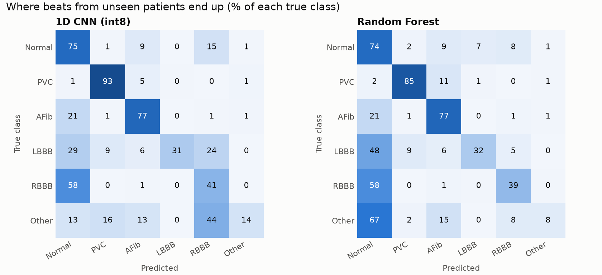
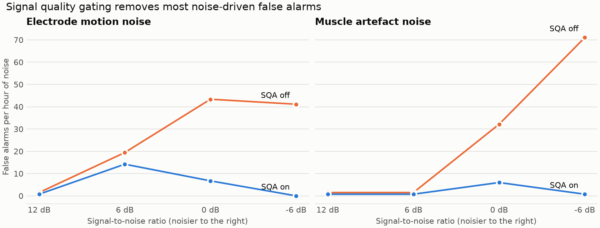

# Results

The classification and robustness figures below describe the models retrained on 2026-11-11, after the "Other" class was narrowed to supraventricular premature beats (see [Third evaluation round](#third-evaluation-round-2026-11-11)). Two sections were not re-run and say so: the AD8232 simulation (2026-11-05 models) and the signal-quality acceptance rates (which do not depend on the models). Runtime maintenance does not count as a new accuracy evaluation; see [Maintenance verification](MAINTENANCE.md) for later checks.

The source measurements are in `results/*.json`. Classifier test metrics use held-out records and patient identifiers. The QRS detector summary uses all 44 non-paced MIT-BIH records, including training records. Resource and emulator measurements are engineering checks, not patient evaluations. Nothing was measured on real AD8232 hardware. See [What has not been tested](#what-has-not-been-tested).

## Summary

| Capability | Result | Verdict |
|---|---|---|
| R-peak detection (44 records, 100,460 beats) | Sensitivity 99.11%, PPV 99.59% | Works well |
| AFib vs normal rhythm | Recall 77%, precision 83% on rhythm windows | Usable |
| PVC detection | Beat F1 0.85 on MIT-BIH test patients | Works well |
| Signal quality gating | False alarms 71.0 → 0.7 per hour at -6 dB muscle noise | Works well |
| LBBB, RBBB | Precision 0.91-1.00, recall 0.61-0.72 on 95 PTB-XL patients. Much worse on MIT-BIH. CNN calls some normal AF-database beats RBBB. | **Unreliable** |
| "Other" (supraventricular premature beats) | Precision 0.57, recall 14% on MIT-BIH test patients | **Weak** |
| ESP32 fit | 17 KB model, 3.7 KB arena | Fits comfortably |

## Classifier comparison

This fills in the table from the project diagram. Scores use each classifier followed by the AF rhythm rule, the way the device runs them.

**All test patients** (123 patients, 99,234 beats):

| Metric | 1D CNN (int8) | Random Forest |
|---|---:|---:|
| Accuracy | 71.6% | 70.9% |
| Precision (macro) | 0.585 | 0.472 |
| Recall (macro) | 0.551 | 0.526 |
| F1-score (macro) | 0.529 | 0.486 |
| Inference time on ESP32 | **Not measured** (estimate 40-60 ms) | **Not measured** |
| Model size | 17 KB, 9,574 parameters | 105 KB, 30 trees, 11,970 nodes |

To complete the inference row, flash a real ESP32, let it run on a demo clip, then type `b` in the serial monitor. The estimate scales Espressif's published person-detection time to this model's roughly 75,000 multiply-accumulates. The library in use runs reference kernels, without ESP-NN acceleration. QEMU is not cycle accurate, so it cannot provide this number.

**By test set:**

| Test set | Patients | Beats | CNN accuracy | CNN macro-F1 | RF accuracy | RF macro-F1 |
|---|---:|---:|---:|---:|---:|---:|
| MIT-BIH DS2 | 22 | 45,849 | 74.4% | 0.571 | 68.6% | 0.522 |
| MIT-BIH AF database | 6 | 52,310 | 69.0% | 0.766 | 72.8% | 0.789 |
| PTB-XL fold 10 | 95 | 1,075 | 84.1% | 0.820 | 79.0% | 0.739 |

**Per class, CNN, precision / recall / F1:**

| Class | MIT-BIH DS2 | AF database | PTB-XL |
|---|---|---|---|
| Normal | 0.82 / 0.87 / 0.84 | 0.81 / 0.63 / 0.71 | 0.82 / 0.99 / 0.90 |
| PVC | 0.79 / 0.93 / 0.85 | - | - |
| AFib | 0.58 / 0.76 / 0.66 | 0.89 / 0.77 / 0.82 | - |
| LBBB | 0.87 / 0.28 / 0.43 | - | 1.00 / 0.72 / 0.83 |
| RBBB | 0.42 / 0.40 / 0.41 | - | 0.91 / 0.61 / 0.73 |
| Other | 0.57 / 0.14 / 0.23 | - | - |

**AF database regression.** The CNN labels 8,232 of the 30,000 normal AF-database beats as RBBB (3,023 with the previous model). That is why its AF-database accuracy fell from 77.1% to 69.0%. The Random Forest does not show this. The likely cause is training length: production training chose 7 epochs from the validation set, while the cross-validation that justified the class change used 4, and kept AF-database macro-F1 at 0.876. This has not been tested, and changing it now would be informed by the test results.

**Which classifier is better?** The CNN has the higher macro-F1 and accuracy, is more precise on PVCs (0.69 vs 0.60 across all test patients) and needs about a sixth of the flash. The Random Forest is better on the AF database and gives the better rhythm verdicts (below). The CNN stays the primary classifier and the Random Forest runs beside it for comparison.

In patient-grouped cross-validation on the training pool, a CNN + Random Forest ensemble and per-class score offsets were also tried. Their tuned settings did not carry over between patient groups (one half of the patients chose RF only, the other CNN only), so neither is used.

### Why these numbers look lower than published papers

Many papers report 95-99%. Most of those use random beat splits, so beats from the same person land in both training and testing. This project keeps every patient on one side of the split. In this project's own development, random-style results would have hidden a complete failure: with MIT-BIH alone, LBBB and RBBB scored F1 = 0 on a new patient.

Inter-patient results are the honest estimate of what happens with a new person, which is the situation at a demo.

### How precise is macro-F1?

Not very. PVC and Other each come from only 15-17 patients outside INCART, and MIT-BIH has one to three patients per side for LBBB and RBBB. A patient-level bootstrap of cross-validation predictions gives a 95% interval of about ±0.10 around the CNN's macro-F1. Differences of a few hundredths between models or runs are not meaningful.

## Rhythm verdict on full recordings

The device smooths per-beat classes into a 10-beat verdict. Scored on 294,346 windows from full test recordings in time order:

| Verdict | CNN recall | CNN precision | RF recall | RF precision |
|---:|---:|---:|---:|---:|
| Normal | 0.82 | 0.85 | 0.84 | 0.84 |
| AFib | 0.77 | 0.83 | 0.77 | 0.84 |
| PVC (frequent) | 0.54 | 0.49 | 0.66 | 0.50 |
| RBBB | 0.09 | 0.01 | 0.11 | 0.03 |
| LBBB | 0.16 | 0.99 | 0.19 | 0.17 |

Overall verdict accuracy is 78.1% for the CNN and 79.5% for the Random Forest (82.3% and 77.7% with the previous models). An RBBB verdict from the CNN on these recordings is almost always wrong, mostly from the AF-database regression above.

## Does signal quality checking help?

This tests the project's key improvement. The middle third of each MIT-BIH test record was corrupted with real recorded noise from the Noise Stress Test Database, then processed with SQA on and off.

| Noise | SNR | Accuracy, SQA off | Accuracy, SQA on | False alarms/h, off | False alarms/h, on |
|---|---:|---:|---:|---:|---:|
| Electrode motion | 12 dB | 72.7% | 73.2% | 1.5 | 0.7 |
| Electrode motion | 6 dB | 61.8% | 67.5% | 19.4 | 14.2 |
| Electrode motion | 0 dB | 36.2% | 61.1% | 43.4 | 6.7 |
| Electrode motion | -6 dB | 17.4% | 60.7%* | 41.1 | 0.0 |
| Muscle artefact | 12 dB | 73.6% | 73.9% | 1.5 | 0.7 |
| Muscle artefact | 6 dB | 71.2% | 71.4% | 1.5 | 0.7 |
| Muscle artefact | 0 dB | 57.6% | 66.9% | 32.2 | 6.0 |
| Muscle artefact | -6 dB | 36.8% | 71.5% | 71.0 | 0.7 |

\* Almost no beats pass at this level (0.3%), so this accuracy rests on very few beats. The false-alarm figure is the meaningful one.

False alarms with the gate on rose compared with the previous model at mild noise (electrode motion 6 dB: 6.7 → 14.2 per hour; 12 dB: 0 → 0.7). Heavy-noise gating is unchanged.

**Acceptance rate on test patients** (signal-quality code only, unchanged since 2026-11-05): 98.0% of clean signal is accepted (worst record 90.0%).

| Noise | 12 dB | 6 dB | 0 dB | -6 dB |
|---|---:|---:|---:|---:|
| Electrode motion | 97% | 84% | 30% | 2% |
| Muscle artefact | 97% | 90% | 55% | 20% |
| Baseline wander | 97% | 95% | 79% | 41% |

**Known limitation:** ventricular flutter and fibrillation have a low-kurtosis waveform that resembles noise, so SQA can report "poor signal" during those rhythms. This prototype must not be relied on to detect them.

## AD8232 front-end simulation

Measured with the **2026-11-05 models** and not re-run. Test patients' ECGs were passed through a software model of the module's filters, mains pickup, and the ESP32 ADC's noise and non-linearity (`ml/ad8232_sim.py`). This estimates robustness only.

| Condition | R-peak sensitivity | PPV | Beats analysed | CNN accuracy |
|---|---:|---:|---:|---:|
| Ideal | 99.28% | 99.91% | 95.6% | 69.1% |
| Typical AD8232 + ESP32 | 99.30% | 99.91% | 91.7% | 68.6% |
| Noisy ADC, strong mains | 99.29% | 99.91% | 91.6% | 68.5% |
| Gain 30% lower than assumed | 99.27% | 99.91% | 96.6% | 66.9% |

## Emulated ESP32 self-test

`tools/run_qemu_selftest.py` boots the real Xtensa firmware binary in Espressif's QEMU.

| Check | Result |
|---|---|
| Boot, TFLM load | Pass, 3,652-byte tensor arena |
| Random Forest vs Python, 240 test beats | 240/240 identical |
| CNN class vs Python, 240 test beats | 240/240 identical, largest score difference 7/256 |
| Full pipeline on 6 demo clips | Detected and analysed beat counts and class counts identical to the PC |

The allowed score difference was raised from 6 to 7 int8 units for this model. Both values are observed bounds, not derived ones; class agreement is the strict check.

Emulation found two bugs that compiling could not: the demo samples lost their sign, and TF 2.20's per-channel Dense weights were silently misread by this TFLite Micro version.

## Demo clip behaviour

Demo clips are 60 s stretches from test patients. Their verdicts are honest and not all correct:

| Clip | CNN verdict | RF verdict | Note |
|---|---|---|---|
| Normal | Normal | Normal | Correct, no alert |
| PVC | PVC | AFib | CNN correct. Only 39% of beats in this stretch are PVCs. |
| AFib | AFib | AFib | Correct at the end of the clip, but the alert barely fires: most beats read Normal |
| LBBB | **Normal** | **Normal** | Wrong at the end of the clip, although the CNN calls 35 of 61 beats LBBB |
| RBBB | RBBB | RBBB | Correct |
| Noise | Normal outside the burst | Normal | Noise burst is gated, 25 of 79 beats analysed |

## How the numbers were obtained: three evaluation rounds

The test set has been evaluated three times. That must be disclosed in any report.

1. **First run (2026-11-05):** MIT-BIH DS2 accuracy 61.2% (CNN) and 60.4% (RF), macro-F1 0.474 and 0.473. AFib recall 18% (CNN). About 50 false alarms per hour.
2. **Diagnosis, no further test-set access:** the confusion matrices showed inflated class priors and database confounding. Further work used patient-grouped cross-validation on the training pool only.
3. **Second run (2026-11-05):** DS2 accuracy 69.1% and 65.0%, macro-F1 0.471 and 0.480. All-patient CNN macro-F1 0.473.
4. **Third run (2026-11-11):** after the class change below, reported above.

Because earlier runs informed later designs, the final figures are not a pure first-look estimate and may be optimistic. First- and second-run results are kept in `results/evaluation_first_run.json` and `results/evaluation_second_run.json`.

### Third evaluation round (2026-11-11)

The old "Other" class mixed supraventricular premature beats with fusion, escape and flutter beats. Only 36% of its beats were premature, and it scored F1 0.03-0.10 in cross-validation whatever was tried. It was narrowed to supraventricular premature beats (A, a, J, S). The other types are no longer labelled, and 355 weakly labelled premature beats from 191 PTB-XL training patients were added (see [Datasets](DATASETS.md)). The decision was made from patient-grouped cross-validation on the training pool, where CNN macro-F1 went from 0.502 to 0.528 and RF from 0.564 to 0.589, both inside the noise range.

| Measure (CNN) | Second run | Third run |
|---|---:|---:|
| All-patient macro-F1 | 0.473 | 0.529 |
| All-patient accuracy | 73.4% | 71.6% |
| DS2 macro-F1 | 0.471 | 0.571 |
| DS2 LBBB F1 | 0.08 | 0.43 |
| DS2 Other F1 | 0.05 | 0.23 |
| PTB-XL macro-F1 | 0.745 | 0.820 |
| AF database accuracy | 77.1% | 69.0% |
| Rhythm verdict accuracy | 82.3% | 78.1% |
| False alarms/h, electrode motion 6 dB, SQA on | 6.7 | 14.2 |

This is a trade-off, not a pure gain. The labels changed between runs, so the macro-F1 values are not strictly like for like: DS2 lost 1,288 fusion and flutter beats from scoring.

## Why LBBB, RBBB and Other are weak

- **Lead:** bundle branch blocks are told apart mainly in chest lead V1. A 3-electrode AD8232 approximates lead II, where they look alike, and differ a lot from person to person.
- **Data:** MIT-BIH has very few patients with these conditions. PTB-XL adds hundreds, but its recordings last only 10 s, in a different hospital setting.
- **Other** now holds only supraventricular premature beats, but these look like normal beats with early timing, and the AF rule can also mistake that irregularity for AF. The added PTB-XL beats have weak labels, set by timing alone.

Suggested wording for the viva: AFib, PVC and Normal are the supported patterns. LBBB, RBBB and supraventricular premature beats are experimental, as the proposal allowed ("depending on dataset availability").

## What has not been tested

- **No real AD8232, electrodes, OLED, buzzer, button or Wi-Fi.** Firmware for those parts compiles, but has never run. QEMU does not emulate them.
- **No real inference timing** on an ESP32.
- **No real human ECG from this hardware.** Objective 10 (experimental signals) is still open. Domain shift between hospital recordings and a dry-lab AD8232 may lower accuracy further than the simulation suggests.
- **The dashboard** was tested against a fake device in Node (`tests/dashboard_check.js`), not in a browser on a phone.
- **The AD8232 simulation** has not been re-run with the 2026-11-11 models.
